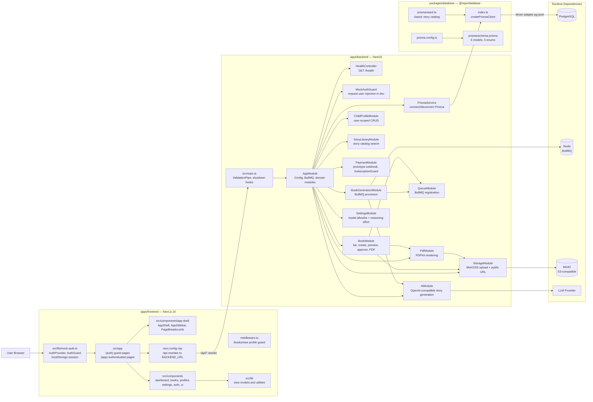
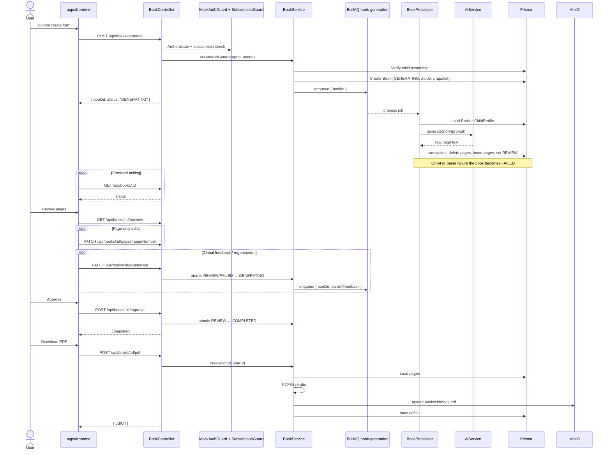
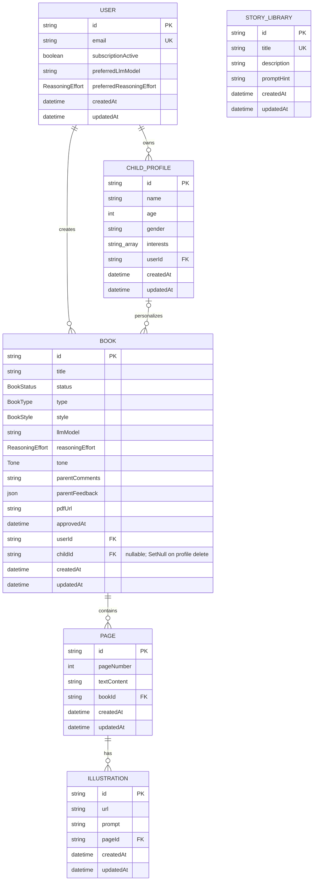

# Project Directory Architecture

Mermaid diagrams for the three primary project directories:

- `apps/frontend` — Next.js 16 application
- `apps/backend` — NestJS API and background worker
- `packages/database` — Prisma schema and client factory

## Runtime Containers

## Main Book Flow

## Book Endpoints

| Endpoint | Method | Guards | Description |
|----------|--------|--------|-------------|
| `GET /books` | GET | MockAuthGuard | Paginated list with filters, sorting, and `statusCounts` |
| `POST /books/generate` | POST | MockAuthGuard + SubscriptionGuard | Create book and enqueue generation |
| `GET /books/:id` | GET | MockAuthGuard | Book detail with child info and pages |
| `GET /books/:id/preview` | GET | MockAuthGuard | Review payload; `409` unless REVIEW/COMPLETED |
| `PATCH /books/:id/pages/:pageNumber` | PATCH | MockAuthGuard | Append a parent edit to page text |
| `PATCH /books/:id/regenerate` | PATCH | MockAuthGuard | REVIEW/FAILED → GENERATING, enqueue with feedback |
| `POST /books/:id/approve` | POST | MockAuthGuard + SubscriptionGuard | REVIEW → COMPLETED |
| `GET /books/:id/pdf` | GET | MockAuthGuard | Return an already stored PDF URL |
| `POST /books/:id/pdf` | POST | MockAuthGuard + SubscriptionGuard | Create if needed, store in MinIO, return URL |

## Database Model

### Enums

| Enum | Values |
|------|--------|
| BookStatus | DRAFT, GENERATING, REVIEW, COMPLETED, FAILED |
| BookType | AI_ADAPTED, MANUAL |
| BookStyle | WATERCOLOR, CARTOON, REALISTIC, PIXAR, SKETCH, MANGA, COMIC |
| Tone | WARM, EDUCATIONAL, PLAYFUL, MAGICAL, ADVENTUROUS |
| ReasoningEffort | LOW, MEDIUM, HIGH |

## Frontend Routes

### Route Group: `(auth)` — Guest-only pages

| Route | Description |
|-------|-------------|
| `/login` | Demo email/password login |
| `/signup` | Demo registration |
| `/forgot-password` | Explains the mock-auth limitation |

### Route Group: `(app)` — Authenticated pages

| Route | Description |
|-------|-------------|
| `/` | Dashboard with filters, status summary, and pagination |
| `/books/new` | Child, story, style, and tone selection |
| `/books/:id` | Status-based redirect; completed detail with PDF download |
| `/books/:id/generating` | Polling and failure/retry state |
| `/books/:id/preview` | Review, edits, regeneration, approval |
| `/profiles` | Child profile CRUD |
| `/settings` | Live generation defaults plus static account panels |
| `/notifications` | Empty-state placeholder |

### Standalone

| Route | Description |
|-------|-------------|
| `/logout` | Clears the local mock session and redirects to `/login` |
